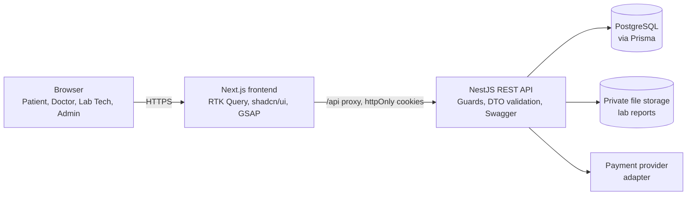

<div align="center">

# 🩺 PULSE

### Healthcare Information & Appointment System

**Find a doctor. Book an appointment. Consult online. Pay securely. Read your lab results.**
One web platform for patients, doctors, lab technicians and admins.


</div>

> **Status:** 🚧 Scaffold only. The folder structure, phase plans and documentation are in place; application code is written phase by phase (see [Development phases](#-development-phases)).
>
> **Disclaimer:** PULSE is a university project. It is not a real medical service. Use fake data only.

---

## 📑 Table of contents

- [About](#-about)
- [Features by role](#-features-by-role)
- [MVP scope](#-mvp-scope)
- [Tech stack](#-tech-stack)
- [Architecture](#-architecture)
- [Repository structure](#-repository-structure)
- [Development phases](#-development-phases)
- [Getting started](#-getting-started)
- [Environment variables](#-environment-variables)
- [Security & privacy](#-security--privacy)
- [Testing](#-testing)
- [Deployment](#-deployment)
- [Documentation](#-documentation)
- [Roadmap](#-roadmap-after-mvp)
- [Team](#-team)
- [Contributing](#-contributing)
- [License](#-license)

---

## 🎯 About

Finding the right doctor, booking a slot and collecting lab reports usually means phone calls, queues and paper. **PULSE** puts these steps in one secure web application:

- Patients search doctors by **specialization, symptoms and location**, then book **physical or online** appointments.
- Doctors manage their profile and schedule, consult, diagnose and issue **electronic prescriptions**.
- Labs upload test results, and patients read them online.
- Admins keep the platform clean: verifying doctors, managing users and health information.

PULSE is the semester project for **Software Construction** at the Department of Computer Science, Quaid-i-Azam University, Islamabad. It is developed with an **incremental process model**: six increments, each tested and integrated before the next one starts.

---

## 👥 Features by role

| Role | What they can do |
| --- | --- |
| **Patient** | Register and manage profile · search doctors (specialization, symptom, location) · view doctor profiles and schedules · book physical or online appointments · pay online · view diagnosis and e-prescriptions · search and book lab tests · view lab results online · browse disease information |
| **Doctor** | Register (admin-verified) · manage profile · define and update schedule · confirm or reject appointments · run online consultations and record diagnosis · issue e-prescriptions · view history and lab results of *their own* patients |
| **Lab technician** | Register (admin-approved) · confirm lab bookings · upload lab test results |
| **Admin** | Manage user accounts (approve, suspend) · verify doctors · manage disease information, symptoms and specializations · manage labs and the lab-test catalogue · review audit logs |
| **Visitor** | Browse verified doctors, disease information and labs without logging in |

---

## 🧭 MVP scope

The MVP covers **every use case** in the project plan (15 from the use case diagram + electronic prescriptions from the plan text). Nothing is postponed to "later"; only extras are (see [Roadmap](#-roadmap-after-mvp)).


| ID | Use case | Actor(s) | Phase |
| --- | --- | --- | :-: |
| UC-01 | User Registration | Unregistered User | 1 |
| UC-02 | Login / Authenticate | Patient, Doctor, Lab Technician, Admin | 1 |
| UC-03 | Manage Doctor Profile | Doctor, Admin | 2 |
| UC-04 | Manage Patient Profile | Patient, Admin | 2 |
| UC-05 | Search for Doctors | Patient (and public visitors) | 3 |
| UC-06 | Make an Appointment | Patient | 3 |
| UC-07 | Search for Lab Tests | Patient | 5 |
| UC-08 | Confirm Appointment | Doctor, Lab Technician | 3, 5 |
| UC-09 | Online Diagnosis | Doctor (Patient views result) | 4 |
| UC-10 | Define / Update Schedule | Doctor | 3 |
| UC-11 | Make Payments | Patient | 5 |
| UC-12 | View Lab Test Results | Patient, Doctor | 5 |
| UC-13 | Upload Lab Test Results | Lab Technician | 5 |
| UC-14 | Manage User Accounts | Admin | 1, 2 |
| UC-15 | Manage Disease Information | Admin | 2 |
| UC-16 | Electronic Prescriptions | Doctor (Patient views) | 4 |

Full traceability (module, page, acceptance check per use case): [`docs/project/use-case-matrix.md`](docs/project/use-case-matrix.md).

---

## 🧰 Tech stack

| Layer | Technology | Why |
| --- | --- | --- |
| Frontend framework | **Next.js** (App Router, TypeScript) | Routing, layouts, SSR/SEO for public pages, easy deployment |
| State & data fetching | **Redux Toolkit (RTK) + RTK Query** | One place for server data, caching and auth state |
| UI components | **shadcn/ui** (Radix UI primitives) | Accessible components we own and can restyle |
| Styling | **Tailwind CSS** | Fast, consistent, design-token friendly |
| Animation | **GSAP** | Smooth, controllable UI motion |
| Forms & validation* | React Hook Form + Zod | Pairs with shadcn/ui forms; same rules as the API |
| Backend | **NestJS** (TypeScript) | Modular structure, guards, DTO validation, built-in testing |
| ORM* | Prisma | Typed queries, readable schema, simple migrations |
| Database | **PostgreSQL** | Relational data, constraints, transactions (booking safety) |
| Auth | JWT in httpOnly cookies + role-based access control | XSS-safe token storage, per-role permissions |
| API docs* | Swagger / OpenAPI | Live, testable API documentation |
| Testing* | Jest + Supertest (API), Playwright (end to end) | Unit, API and full-flow tests |
| CI/CD* | GitHub Actions | Lint, test and build on every pull request |
| Local infrastructure* | Docker Compose | One command for a local database |

<sub>* Recommended additions, not part of the original stack. Prisma in particular can be swapped for TypeORM before Phase 0 without changing the phase plan.</sub>

---

## 🏗 Architecture



Key ideas (details in [`docs/architecture/system-architecture.md`](docs/architecture/system-architecture.md)):

- **The browser only talks to the frontend origin.** Next.js proxies `/api/*` to NestJS, so cookies are first-party and CORS stays simple.
- **Security lives in the API.** Hiding a button is UX; every endpoint is protected by guards and ownership checks.
- **Providers behind interfaces.** Payments and file storage sit behind adapters, so a mock works in development and a real service in production.
- **One migration set, grown phase by phase.** Each increment adds its own tables.

---

## 📁 Repository structure

```text
pulse/
├── README.md
├── AGENTS.md                  # Rules for AI coding assistants (read this before vibe coding)
├── CONTRIBUTING.md            # Git workflow and PR rules
├── CHANGELOG.md
├── docker-compose.yml         # Local PostgreSQL
├── .env.example
├── .github/                   # CI workflows, PR and issue templates
│
├── docs/
│   ├── README.md              # Documentation index
│   ├── project/               # Use cases, roles & permissions, repo structure
│   ├── architecture/          # System, database, API, security, deployment
│   ├── phases/                # One folder per phase: plan + checklist (no code)
│   │   ├── phase-0-foundation/
│   │   ├── phase-1-authentication/
│   │   ├── phase-2-profiles-and-disease-info/
│   │   ├── phase-3-search-and-booking/
│   │   ├── phase-4-consultation-and-prescriptions/
│   │   ├── phase-5-payments-and-lab-tests/
│   │   └── phase-6-integration-and-deployment/
│   └── vibe-coding/           # How to build this repo with an AI assistant
│
├── backend/                   # NestJS API
│   ├── prisma/                # schema.prisma, migrations, seed
│   ├── src/
│   │   ├── config/            # Typed env config + validation
│   │   ├── database/          # Prisma module and service
│   │   ├── common/            # Decorators, guards, filters, interceptors, DTOs, utils
│   │   └── modules/           # auth, users, patients, doctors, specializations, diseases,
│   │                          # symptoms, schedules, appointments, consultations, prescriptions,
│   │                          # labs, lab-bookings, lab-results, payments, storage, audit, health
│   └── test/                  # End-to-end tests
│
└── frontend/                  # Next.js app
    ├── public/
    ├── e2e/                   # Playwright tests
    └── src/
        ├── app/               # Routes: (public), (auth), (dashboard)/{patient,doctor,lab,admin}
        ├── components/        # ui (shadcn), layout, common, animations, providers
        ├── features/          # One folder per domain: components, api (RTK Query), schemas, types
        ├── store/             # Redux store + RTK Query base API
        ├── lib/  hooks/  types/  config/
        └── middleware.ts      # Route protection
```

The complete file-by-file tree, with the phase and purpose of every file, is in [`docs/project/repository-structure.md`](docs/project/repository-structure.md).

---

## 🚦 Development phases

Incremental model: **build → test → integrate → next increment.** Each phase has its own plan and checklist in `docs/phases/`, and contains **no code**, only what to build and how to know it is done.

| # | Phase | Increment | Use cases | Target dates | Plan |
| :-: | --- | --- | --- | --- | --- |
| 0 | **Foundation & Setup** | Setup | Foundation | Now → 2026-11-06 (repo and tooling ideally by 2026-10-02; schema and UI design by 2026-11-06) | [Plan](docs/phases/phase-0-foundation/README.md) · [Checklist](docs/phases/phase-0-foundation/checklist.md) |
| 1 | **Authentication & User Accounts** | Increment 1 (Sprint 1) | UC-01, UC-02, UC-14 (basic) | 2026-11-09 → 2026-11-13 | [Plan](docs/phases/phase-1-authentication/README.md) · [Checklist](docs/phases/phase-1-authentication/checklist.md) |
| 2 | **Profiles & Disease Information** | Increment 2 (Sprint 2, part 1) | UC-03, UC-04, UC-15, UC-14 (doctor verification) | 2026-11-14 → 2026-11-20 | [Plan](docs/phases/phase-2-profiles-and-disease-info/README.md) · [Checklist](docs/phases/phase-2-profiles-and-disease-info/checklist.md) |
| 3 | **Doctor Search, Schedules & Appointment Booking** | Increment 3 (Sprint 2 part 2 + Sprint 3) | UC-05, UC-06, UC-08 (doctor side), UC-10 | 2026-11-21 → 2026-11-27 | [Plan](docs/phases/phase-3-search-and-booking/README.md) · [Checklist](docs/phases/phase-3-search-and-booking/checklist.md) |
| 4 | **Online Consultation, Diagnosis & E-Prescriptions** | Increment 4 (Sprint 3 part 2) | UC-09, UC-16 | 2026-11-28 → 2026-12-02 | [Plan](docs/phases/phase-4-consultation-and-prescriptions/README.md) · [Checklist](docs/phases/phase-4-consultation-and-prescriptions/checklist.md) |
| 5 | **Payments & Lab Tests** | Increment 5 (Sprint 4) | UC-07, UC-08 (lab side), UC-11, UC-12, UC-13 | 2026-12-03 → 2026-12-07 | [Plan](docs/phases/phase-5-payments-and-lab-tests/README.md) · [Checklist](docs/phases/phase-5-payments-and-lab-tests/checklist.md) |
| 6 | **Integration, Testing & Deployment** | Increment 6 | All 16 (regression pass) | 2026-12-08 → 2026-12-16 (submission 2026-12-17, presentation 2026-12-18) | [Plan](docs/phases/phase-6-integration-and-deployment/README.md) · [Checklist](docs/phases/phase-6-integration-and-deployment/checklist.md) |

Target dates follow the schedule in the project plan (Development: 9 Nov – 7 Dec 2026, Testing: 8 – 16 Dec, Submission: 17 Dec, Presentation: 18 Dec). Adjust them as the team sees fit.

---

## 🚀 Getting started

> The repo currently contains the scaffold (placeholder files). Phase 0 turns it into a running app. The commands below describe the intended workflow **once Phase 0 is done**.

### Prerequisites

- Node.js (current LTS) and npm
- Docker Desktop (or a local PostgreSQL installation)
- Git

### Run locally

```bash
# 1. Clone
git clone https://github.com/<your-username-or-org>/pulse.git
cd pulse

# 2. Start PostgreSQL
cp .env.example .env
docker compose up -d

# 3. Backend (http://localhost:4000, Swagger at /api/docs)
cd backend
cp .env.example .env
npm install
npx prisma migrate dev
npx prisma db seed
npm run start:dev

# 4. Frontend (http://localhost:3000) - in a second terminal
cd frontend
cp .env.example .env.local
npm install
npm run dev
```

### First step of Phase 0: bootstrapping over the placeholders

`create-next-app` and `nest new` refuse to run inside a non-empty folder, and the scaffold folders are intentionally not empty. Two safe options:

1. **Scratch-folder method.** Run each generator in a temporary folder, then copy its generated config files (`package.json`, `tsconfig*.json`, `next.config.*`, `nest-cli.json`, ESLint / PostCSS config) into `frontend/` or `backend/`. Do **not** overwrite the `src/` placeholders.
2. **Let your AI assistant do it.** `AGENTS.md` and [`docs/phases/phase-0-foundation`](docs/phases/phase-0-foundation/README.md) describe exactly what to do.

Check each generator's current prompts and flags when you run it, since they change between versions.

### Demo accounts

Created by the seed script in Phase 6 (fake data only): one Patient, one Doctor, one Lab Technician, one Admin. Credentials are read from environment variables and are never committed.

---

## 🔧 Environment variables

Never commit real `.env` files. Only the `.env.example` files are tracked.

| Variable | Where | Purpose |
| --- | --- | --- |
| `POSTGRES_USER`, `POSTGRES_PASSWORD`, `POSTGRES_DB` | root `.env` | Local database container |
| `DATABASE_URL` | backend | PostgreSQL connection string |
| `PORT`, `NODE_ENV`, `FRONTEND_URL` | backend | Server settings and allowed frontend origin |
| `JWT_ACCESS_SECRET`, `JWT_ACCESS_EXPIRES_IN` | backend | Access token signing and lifetime |
| `JWT_REFRESH_SECRET`, `JWT_REFRESH_EXPIRES_IN` | backend | Refresh token signing and lifetime |
| `COOKIE_SECURE`, `COOKIE_DOMAIN` | backend | Cookie flags for production |
| `THROTTLE_TTL`, `THROTTLE_LIMIT` | backend | Rate limiting |
| `APP_TIMEZONE` | backend | Single timezone used for schedules and slots |
| `STORAGE_DRIVER` (`local` \| `cloud`), `STORAGE_LOCAL_DIR`, `STORAGE_CLOUD_*` | backend | Lab report storage |
| `PAYMENT_PROVIDER` (`mock` \| `gateway`), `PAYMENT_CURRENCY`, `PAYMENT_GATEWAY_*`, `PAYMENT_WEBHOOK_SECRET` | backend | Payments |
| `SEED_ADMIN_EMAIL`, `SEED_ADMIN_PASSWORD` | backend | First admin account created by the seed |
| `API_PROXY_TARGET` | frontend | Backend URL the Next.js `/api` rewrite points to |
| `NEXT_PUBLIC_APP_NAME` | frontend | Display name |

---

## 🔐 Security & privacy

- Passwords are hashed; tokens live in **httpOnly cookies**, never in `localStorage`.
- **Role-based access control** on every endpoint, plus ownership checks (a patient only sees their own data).
- Doctors and lab technicians must be **verified by an admin**; only verified doctors can issue prescriptions.
- Doctors see a patient's history and lab results **only if they have treated that patient**.
- Admins manage the platform but **cannot read medical content** (diagnoses, prescriptions, lab files).
- Lab reports are stored privately and served only through an authenticated endpoint.
- Input validation on every request; rate limiting; Helmet security headers; audit log for reads of medical data.
- The platform never stores card data; payment callbacks are signature-verified.

Full details: [`docs/architecture/auth-and-security.md`](docs/architecture/auth-and-security.md).

---

## 🧪 Testing

| Level | Tool | Where |
| --- | --- | --- |
| Unit | Jest | `*.spec.ts` next to services |
| API / integration | Jest + Supertest | `backend/test/` |
| End to end | Playwright | `frontend/e2e/` |
| Manual acceptance | Checklists | `docs/phases/*/checklist.md` |

Every phase lists its test scenarios in its plan. Phase 6 adds a full role × endpoint permission test.

---

## ☁️ Deployment

The app is designed to be deployable from day one: environment-driven config, health check endpoint, migrations run on release, private file storage and a payment adapter that works with a mock or a real gateway.

Suggested setup: Next.js on a Next-friendly host, NestJS on a container / web-service host, managed PostgreSQL, S3-compatible storage. Options, release steps and a pre-demo checklist: [`docs/architecture/deployment.md`](docs/architecture/deployment.md).

---

## 📚 Documentation

| Doc | Description |
| --- | --- |
| [`docs/README.md`](docs/README.md) | Documentation index |
| [`docs/project/use-case-matrix.md`](docs/project/use-case-matrix.md) | Use case → phase → module → page |
| [`docs/project/roles-and-permissions.md`](docs/project/roles-and-permissions.md) | Who can do what |
| [`docs/architecture/system-architecture.md`](docs/architecture/system-architecture.md) | Architecture and decisions |
| [`docs/architecture/database-design.md`](docs/architecture/database-design.md) | ERD and entities |
| [`docs/architecture/api-design.md`](docs/architecture/api-design.md) | API conventions and endpoint index |
| [`docs/architecture/auth-and-security.md`](docs/architecture/auth-and-security.md) | Authentication and security rules |
| [`docs/architecture/deployment.md`](docs/architecture/deployment.md) | Hosting and release |
| [`docs/vibe-coding/workflow.md`](docs/vibe-coding/workflow.md) | Building this repo with an AI assistant |
| [`AGENTS.md`](AGENTS.md) | Rules that AI assistants must follow |

---

## 🗺 Roadmap after MVP

Ideas that are deliberately **not** in the MVP: in-app real-time chat and video, notifications (email / in-app), doctor reviews and ratings, appointment rescheduling, prescription and receipt PDFs, forgot-password and email verification, multi-language (English / Urdu), dark mode.

---

## 🧑‍💻 Team

**Quaid-i-Azam University, Islamabad · Department of Computer Science · Software Construction**
Supervised by **Dr. Onaiza Maqbool**

| Name | Role |
| --- | --- |
| Mujeeb Arshad | Team Lead |
| Rayyan Umer | Team Member |
| Huzaifa Aousaf | Team Member |

---

## 🤝 Contributing

Branching, commit style and PR rules are in [`CONTRIBUTING.md`](CONTRIBUTING.md). If you use an AI assistant, point it at [`AGENTS.md`](AGENTS.md) first.

---

## 📄 License

To be decided by the team before the repository is made public. Until then, all rights reserved. See [`LICENSE`](LICENSE).
