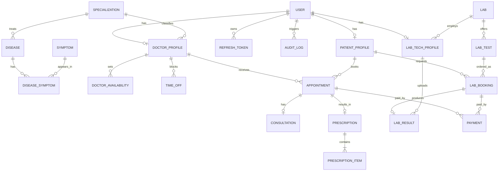
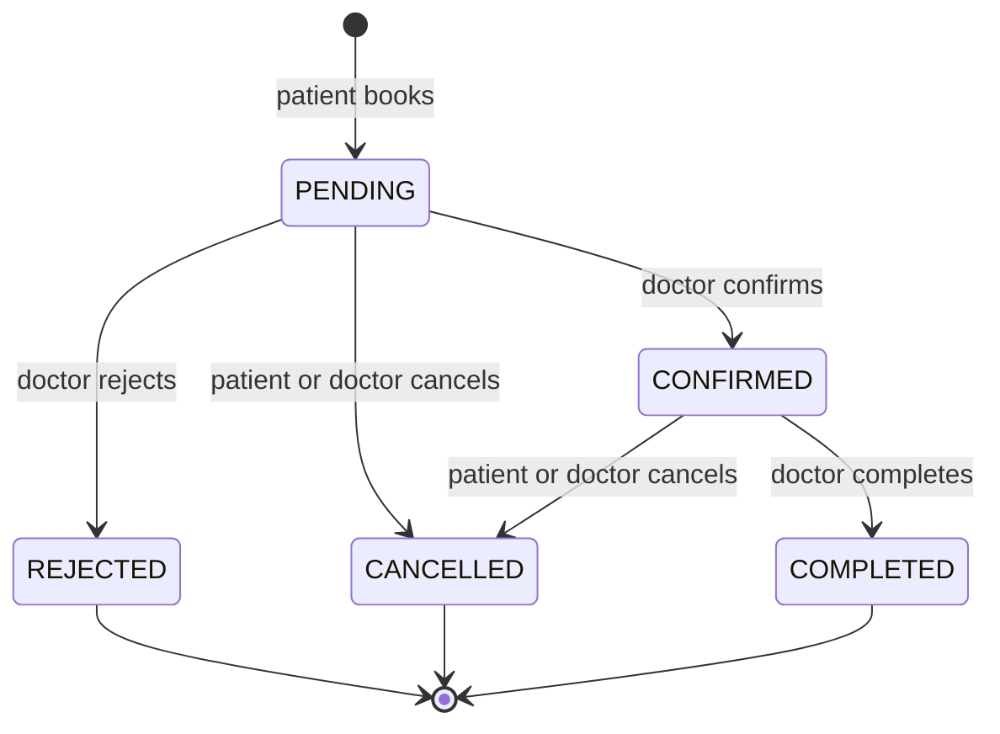

# Database Design

PostgreSQL, accessed through Prisma. This document is the plan; the executable schema lives in `backend/prisma/schema.prisma` and grows phase by phase.

## Entity relationship diagram

## Entities

| Entity | Phase | Key fields | Notes |
| --- | --- | --- | --- |
| `User` | 1 | id, email (unique), passwordHash, fullName, phone, role, status | Single login table for all roles |
| `RefreshToken` | 1 | id, userId, tokenHash, expiresAt, revokedAt | Stored hashed; rotated on refresh |
| `PatientProfile` | 2 | userId (unique), dateOfBirth, gender, bloodGroup, address, emergencyContact | Created on first save |
| `DoctorProfile` | 2 | userId (unique), specializationId, qualifications, experienceYears, licenseNumber, clinicName, city, area, address, consultationFee, offersOnline, bio, isVerified | Public only when verified and user ACTIVE |
| `Specialization` | 2 | id, name (unique) | Admin managed |
| `Disease` | 2 | id, name, slug (unique), overview, causes, treatment, prevention, specializationId | Admin managed |
| `Symptom` | 2 | id, name (unique) | Admin managed |
| `DiseaseSymptom` | 2 | diseaseId, symptomId | Composite key; join table |
| `DoctorAvailability` | 3 | doctorId, dayOfWeek, startTime, endTime, slotMinutes | Weekly repeating windows |
| `TimeOff` | 3 | doctorId, startDate, endDate, reason | Blocks slots |
| `Appointment` | 3 | id, patientId, doctorId, type, status, startsAt, endsAt, reason, meetingUrl, fee | Unique (doctorId, startsAt) while active |
| `Consultation` | 4 | appointmentId (unique), diagnosis, notes, meetingUrl | One per appointment |
| `Prescription` | 4 | appointmentId (unique), doctorId, patientId, issuedAt, notes | One per appointment |
| `PrescriptionItem` | 4 | prescriptionId, medicine, dosage, frequency, duration, instructions | 1..n per prescription |
| `Lab` | 5 | id, name, city, address, phone | Admin managed |
| `LabTest` | 5 | id, labId, name, price, description, preparationNotes | Searchable catalogue |
| `LabTechProfile` | 5 | userId (unique), labId | Links a technician to a lab |
| `LabBooking` | 5 | id, patientId, labTestId, scheduledAt, status | |
| `LabResult` | 5 | id, labBookingId (unique), fileKey, mimeType, sizeBytes, summary, uploadedById, uploadedAt | File itself is private |
| `Payment` | 5 | id, payerId, purpose, appointmentId?, labBookingId?, amount, currency, provider, providerRef, status, paidAt | Exactly one of the two target ids is set |
| `AuditLog` | 6 | id, userId, action, entityType, entityId, createdAt | Reads of medical data |

## Enums

| Enum | Values |
| --- | --- |
| `Role` | PATIENT, DOCTOR, LAB_TECHNICIAN, ADMIN |
| `UserStatus` | ACTIVE, PENDING_VERIFICATION, SUSPENDED |
| `AppointmentType` | PHYSICAL, ONLINE |
| `AppointmentStatus` | PENDING, CONFIRMED, REJECTED, CANCELLED, COMPLETED |
| `LabBookingStatus` | PENDING, CONFIRMED, COMPLETED, CANCELLED |
| `PaymentStatus` | PENDING, PAID, FAILED, REFUNDED |
| `PaymentPurpose` | APPOINTMENT, LAB_BOOKING |

## Appointment status flow

## Rules the database must enforce

- `User.email` unique; `DoctorProfile.userId`, `PatientProfile.userId`, `LabTechProfile.userId` unique.
- No two **active** (PENDING or CONFIRMED) appointments for the same doctor and `startsAt`. This is a *partial* unique index; if your Prisma version cannot declare it in `schema.prisma`, add it as raw SQL inside the migration (`prisma migrate dev --create-only`, edit the SQL, then apply).
- One consultation and one prescription per appointment; one result per lab booking.
- A payment targets exactly one of appointment or lab booking.
- Foreign keys everywhere; deleting a specialization / lab that is in use is blocked, users are suspended rather than deleted.

## Conventions

- Primary keys are UUIDs (no guessable ids in URLs).
- Every table has `createdAt` and `updatedAt`.
- Prisma models in PascalCase, tables mapped to `snake_case`.
- Timestamps are UTC (`timestamptz`); schedule windows are interpreted in `APP_TIMEZONE`.
- Money is stored as an integer in the smallest currency unit (or a fixed-precision decimal), never as a float.
- Indexes: foreign keys used in lists, `Appointment(doctorId, startsAt)`, `DoctorProfile(city, specializationId)`, `Disease(slug)`, `LabTest(name)`.
