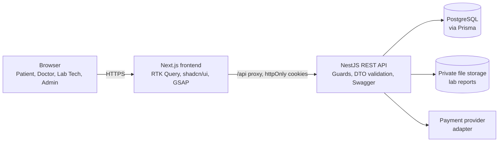

# System Architecture

## 1. Overview

PULSE is a three-tier web application in one repository.

| Tier | Technology | Responsibility |
| --- | --- | --- |
| Presentation | Next.js, RTK Query, shadcn/ui, Tailwind, GSAP | Pages, forms, client state, animations |
| Application | NestJS | Authentication, authorization, business rules, validation |
| Data | PostgreSQL + Prisma | Persistent data, constraints, transactions |
| Integrations | Storage adapter, payment adapter | Lab report files, online payments |

## 2. Request lifecycle

1. The browser requests a page from Next.js, or calls `/api/...`.
2. Next.js forwards `/api/*` to NestJS (rewrite proxy), so cookies stay first-party.
3. NestJS global guards run: `JwtAuthGuard` (is the token valid, is the user ACTIVE?) then `RolesGuard` (is the role allowed?).
4. The validation pipe checks the DTO (whitelist, types, ranges).
5. The controller calls a service. The service applies business rules and **ownership / relationship checks**, then talks to Prisma.
6. PostgreSQL enforces constraints (unique, foreign keys, double-booking index).
7. The response interceptor wraps the result in the standard envelope; the exception filter formats errors.

## 3. Backend module boundaries

Each domain is a NestJS module: `module`, `controller`, `service`, `dto/`, unit tests. Modules talk through exported services, never through each other's tables.

| Module | Depends on |
| --- | --- |
| `auth` | `users`, `database` |
| `doctors` | `specializations`, `diseases` (symptom search), `appointments` (relationship rule) |
| `schedules` | `doctors`, `appointments` (to subtract booked slots) |
| `appointments` | `schedules`, `doctors`, `patients`, `payments` (paid status) |
| `consultations`, `prescriptions` | `appointments`, `doctors` (relationship rule) |
| `lab-bookings` | `labs`, `payments` |
| `lab-results` | `lab-bookings`, `storage`, `doctors` (relationship rule), `audit` |
| `payments` | `appointments`, `lab-bookings` |

## 4. Frontend organisation

- `app/` holds routes only, grouped as `(public)`, `(auth)`, `(dashboard)/{patient,doctor,lab,admin}`.
- `features/<domain>/` holds everything for one domain: components, RTK Query endpoints, Zod schemas, types.
- `components/` holds shared building blocks (shadcn `ui`, layout, common, animations, providers).
- `store/` has the Redux store and the RTK Query base API (credentials, refresh-on-401).

## 5. Key decisions

| Topic | Decision | Reason | Alternative considered |
| --- | --- | --- | --- |
| Repo layout | Monorepo, two apps | One repo, one CI, one issue board for a 3-person team | Two repositories |
| API style | REST + OpenAPI (Swagger) | Simple, testable in the browser, easy to defend | GraphQL |
| ORM | Prisma | Typed queries, readable schema, simple migrations | TypeORM |
| Token storage | JWT in httpOnly cookies, refresh rotation | JavaScript cannot read the tokens (XSS-safe) | Tokens in `localStorage` |
| Browser ↔ API | Next.js `/api` rewrite proxy | First-party cookies, no CORS trouble across hosts | Direct cross-origin calls |
| Migrations | One set, grown per phase | Matches the incremental model; each increment is shippable | One giant schema up front |
| Slots | Computed on request | No stale slot rows; schedule edits apply instantly | Pre-generated slot table |
| Double-booking | DB unique constraint + transaction | Correct even under simultaneous requests | Check in code only |
| Online consultation | Meeting link in the MVP | No video infrastructure to build or maintain | Built-in video / chat (stretch) |
| Payments | Provider adapter, mock first | Gateway availability is a plan constraint; the app stays independent of it | Hard-wire one gateway |
| Lab files | Private storage, authenticated endpoint | Medical documents must not have public URLs | Public bucket links |
| Admin and medical data | Admin cannot read medical content | Least privilege | Admin sees everything |
| Time | Store UTC; one configured `APP_TIMEZONE` for schedules | Avoids the classic timezone bugs | Per-doctor timezone (stretch) |

## 6. Cross-cutting concerns

- **Validation:** DTOs on the API (`class-validator`), Zod on the frontend with matching rules.
- **Errors:** stable error codes, never raw exceptions to clients.
- **Logging:** request logs without bodies; audit log for reads of medical data (Phase 6).
- **Config:** environment variables, validated at startup.
- **Observability (minimum):** health endpoint, structured logs on the host.
