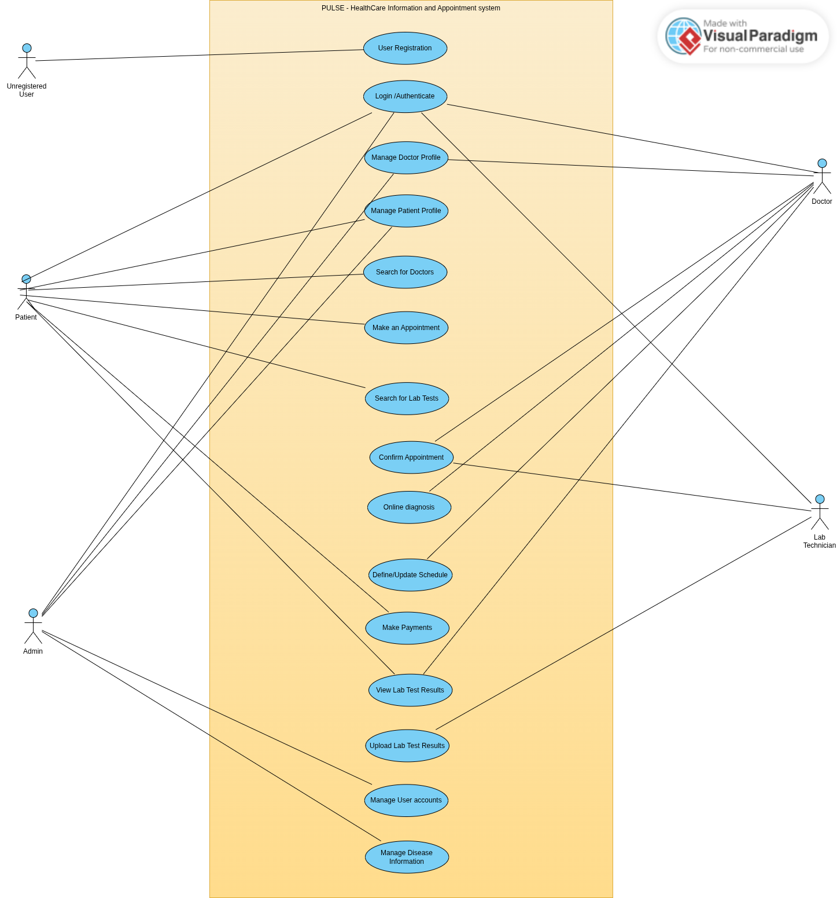

# Use Case Matrix

Traceability from the project plan to the code. Every use case must reach ✅ before the final presentation.

Source: use case diagram in the project plan (`use-case-diagram.png`, UC-01 to UC-15) plus electronic prescriptions from the plan text (UC-16).

| ID | Use case | Actor(s) | Phase | Backend module(s) | Frontend routes | Acceptance check | Done |
| --- | --- | --- | :-: | --- | --- | --- | :-: |
| UC-01 | User Registration | Unregistered User | 1 | auth | /register, /pending-verification | A patient registers and reaches the dashboard; a doctor registers and sees the pending page. | ⬜ |
| UC-02 | Login / Authenticate | Patient, Doctor, Lab Technician, Admin | 1 | auth | /login | Login redirects by role; refresh works silently; logout clears the session; suspended / pending accounts are refused. | ⬜ |
| UC-03 | Manage Doctor Profile | Doctor, Admin | 2 | doctors, specializations | /doctor/profile, /doctors/[doctorId], /admin/users/[userId] | Doctor edits profile; admin verifies; verified profile appears publicly, unverified does not. | ⬜ |
| UC-04 | Manage Patient Profile | Patient, Admin | 2 | patients | /patient/profile | Patient updates own profile; another patient cannot read it; admin can edit. | ⬜ |
| UC-05 | Search for Doctors | Patient (and public visitors) | 3 | doctors, diseases, symptoms | /doctors | Search by specialization, symptom and city returns the right verified doctors. | ⬜ |
| UC-06 | Make an Appointment | Patient | 3 | appointments, schedules | /patient/book/[doctorId], /patient/appointments | Patient books a free slot for physical or online; a taken slot is refused; patient can cancel. | ⬜ |
| UC-07 | Search for Lab Tests | Patient | 5 | labs, lab-bookings | /labs, /labs/[labId], /patient/lab-bookings | Patient finds a test by name / lab / city and books it. | ⬜ |
| UC-08 | Confirm Appointment | Doctor, Lab Technician | 3, 5 | appointments, lab-bookings | /doctor/appointments, /lab/bookings | Doctor confirms or rejects appointment requests; lab technician confirms lab bookings of their own lab. | ⬜ |
| UC-09 | Online Diagnosis | Doctor (Patient views result) | 4 | consultations | /doctor/appointments/[appointmentId], /patient/appointments/[appointmentId], /doctor/patients/[patientId] | Doctor saves a diagnosis; patient sees it; nobody else does. | ⬜ |
| UC-10 | Define / Update Schedule | Doctor | 3 | schedules | /doctor/schedule | Changing availability or adding time off changes the slots offered. | ⬜ |
| UC-11 | Make Payments | Patient | 5 | payments | /patient/payments, /patient/payments/[paymentId] | Patient pays for a confirmed appointment or lab booking; status becomes PAID; online meeting link is released. | ⬜ |
| UC-12 | View Lab Test Results | Patient, Doctor | 5 | lab-results | /patient/lab-results, /doctor/patients/[patientId] | Patient and a related doctor open a result; unrelated users cannot. | ⬜ |
| UC-13 | Upload Lab Test Results | Lab Technician | 5 | lab-results, storage | /lab/bookings/[bookingId] | Technician uploads a valid file; booking becomes COMPLETED; wrong file types are rejected. | ⬜ |
| UC-14 | Manage User Accounts | Admin | 1, 2 | users, doctors | /admin/users, /admin/users/[userId] | Admin approves a pending doctor; a suspended user can no longer log in. | ⬜ |
| UC-15 | Manage Disease Information | Admin | 2 | diseases, symptoms, specializations | /admin/diseases, /admin/symptoms, /admin/specializations, /diseases | Admin adds a disease; it shows publicly and is found by symptom search. | ⬜ |
| UC-16 | Electronic Prescriptions | Doctor (Patient views) | 4 | prescriptions | /doctor/appointments/[appointmentId], /patient/prescriptions | Verified doctor issues a prescription; patient views and prints it; unverified doctor cannot. | ⬜ |

## Notes

- **UC-08 has two halves:** doctors confirm appointments (Phase 3), lab technicians confirm lab bookings (Phase 5).
- **UC-14 has two halves:** account approval / suspension (Phase 1), doctor verification (Phase 2).
- **Out of scope:** the plan's "Project Tracking" bullet (students and supervisors monitoring progress) is not in the use case diagram and does not describe PULSE's users. It is treated as leftover text and excluded from the MVP.
- **Assumption to confirm:** admins manage labs, the lab-test catalogue and technician assignment. The diagram does not show this actor-use case pair, but "Search for Lab Tests" needs the data to exist.
